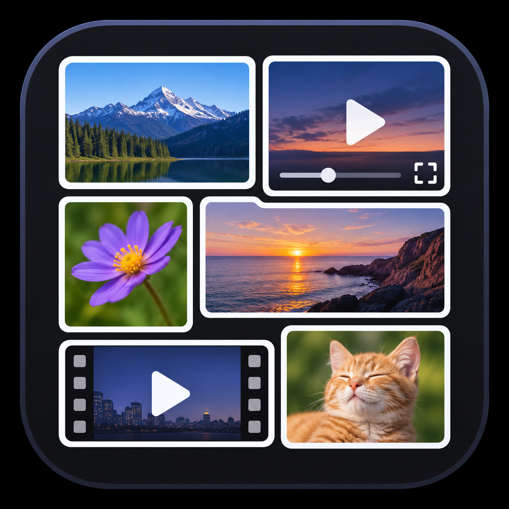
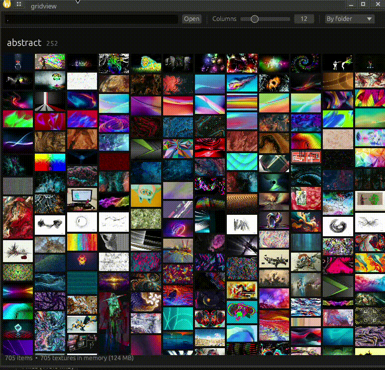

#  gridview - masonry image/video gallery



Rewrite of the Electron version, built for folders with tens of thousands of files. Made to be faster.

## Build (Linux)

### Requirements

<details><summary>Debian / Ubuntu</summary>

```sh
sudo apt update
sudo apt install build-essential pkg-config clang libclang-dev \
    libavcodec-dev libavformat-dev libavutil-dev \
    libswscale-dev libswresample-dev \
    libxkbcommon-dev libwayland-dev libgl1-mesa-dev \
    libgstreamer1.0-dev libgstreamer-plugins-base1.0-dev
```

</details>

<details><summary>Arch Linux</summary>

```sh
sudo pacman -Sy --needed base-devel pkgconf clang \
    ffmpeg libclang \
    libxkbcommon wayland mesa \
    gstreamer gst-plugins-base gst-plugins-good \
    gst-plugins-bad gst-plugins-ugly gst-libav
```

</details>

```sh
cargo build --release
```

No ffmpeg dev libs? `cargo build --release --no-default-features` (no video thumbnails).

## Install
From a release tarball (Linux): unpack it and run `./install.sh` (`./uninstall.sh` removes it again).

From source:
```sh
./install.sh
```

## More
See [DOCS.md](DOCS.md).