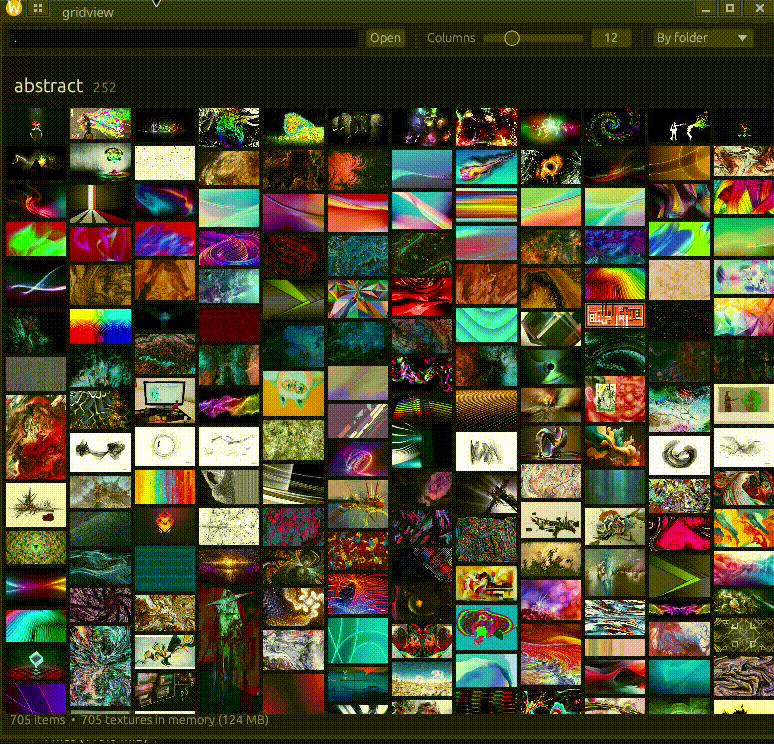

# gridview (Rust)

Masonry image/video gallery. 




Rewrite of the Electron version, built for folders with tens of thousands of files. Made to be faster.

## Build (Linux)

### Requirements

<details><summary>Debian / Ubuntu</summary>

```
sudo apt update
sudo apt install build-essential pkg-config clang libclang-dev \
    libavcodec-dev libavformat-dev libavutil-dev \
    libswscale-dev libswresample-dev \
    libxkbcommon-dev libwayland-dev libgl1-mesa-dev
```

</details>

<details><summary>Arch Linux</summary>

```
sudo pacman -Sy --needed base-devel pkgconf clang \
    ffmpeg libclang \
    libxkbcommon wayland mesa
```

</details>

```
cargo build --release
```

No ffmpeg dev libs? `cargo build --release --no-default-features` (no video thumbnails).

## Install
```
./install.sh
```

## Use
- Open a folder via the path box, CLI arg (e.g. ```gridview .```, ```gridview ~/Pictures```), or drag & drop a folder onto the window
- Columns slider, or Ctrl+scroll / pinch
- Grouping: by folder / date modified / date created (day or month), always recursive
- Click a tile for the viewer: Left/Right = prev/next, Esc = close, Enter = open in system player

Cache lives in `~/.cache/gridview` (thumbnails + image sizes); delete it any time.
